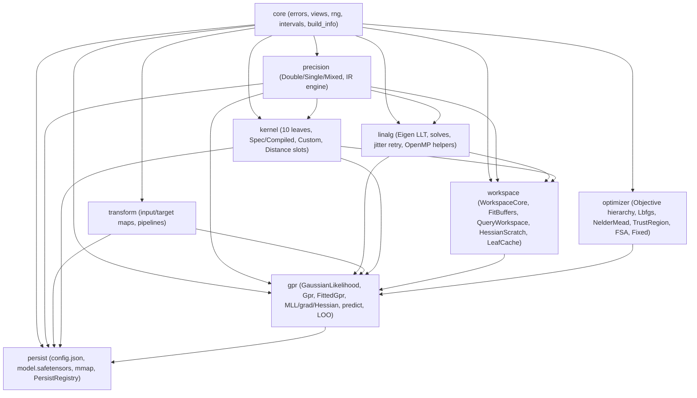

# アーキテクチャとモジュール依存境界

本ドキュメントは `cxxgpr` の階層構造とモジュール間の許可された依存方向を定める。M0-2 で導入する静的アーキテクチャ検査（`just arch-check` / `tools/qa/arch_check.py`）はこの表を正本として `#include` グラフを検証する。

## レイヤ図

矢印 `A --> B` は「B が A に依存してよい」ことを表す（DAG であり、循環および逆方向参照を禁ずる）。

## 許可された依存マトリクス

`tools/qa/arch_check.py` は以下の `ARCH-MODULE-DEPS` 表を読み、各モジュールの公開・内部 `#include "cxxgpr/<dep>/..."` が許可集合に含まれていることを検査する。

| モジュール | 許可される直接依存モジュール | 解説 |
|---|---|---|
| `core` | （なし） | 最下層。エラー型・ビュー型・チェック済み算術・乱数・ビルド情報 |
| `precision` | `core` | 精度ポリシータグと反復改良収束判定 |
| `linalg` | `core`, `precision` | Eigen 密行列 Cholesky・三角行列求解・Jitter ループ・OpenMP 補助 |
| `transform` | `core` | 入力と目的変数の学習前・学習後変換およびカスタム基底 |
| `kernel` | `core`, `precision` | カーネル仕様・コンパイル木・供給二乗距離スロット・`KernelTerm<T>` |
| `workspace` | `core`, `precision`, `linalg`, `kernel` | 事前確保バッファ、距離キャッシュ、ヘッセ行列スクラッチ、葉キャッシュ |
| `optimizer` | `core` | 目的関数インターフェース、logit 変換、各種最適化ソルバ |
| `gpr` | `core`, `precision`, `linalg`, `transform`, `kernel`, `workspace`, `optimizer` | Exact GPR の学習・推論・NLML・勾配・ヘッセ・LOO 統合 |
| `persist` | `core`, `precision`, `transform`, `kernel`, `gpr` | モデルのシリアライズ・デシリアライズと `mmap` 読込 |

## 第三者ヘッダ隔離境界

次の境界を違反したファイルは `just arch-check` で即座に失敗させる。

1. **公開ヘッダ非露出境界（`include/cxxgpr/**`）**：
   - `<Eigen/...>`、`Eigen` 関連マクロ依存型を `#include` してはならない。
   - `<nlohmann/...>` を `#include` してはならない。ユーザーカスタム永続化状態は軽量な JSON 文字列または専用抽象経由とし、`nlohmann::json` 型を公開 API に出さない。
   - `<omp.h>` を `#include` してはならない。
   - `detail/` 配下の非公開ヘッダや `src/` 側ファイルを `#include` してはならない。
2. **内部実装層（`src/<module>/**`）**：
   - `linalg`・`workspace`・`gpr` の実装 `.cpp`（および `src/` 内のプライベートヘッダ）のみが Eigen（`EIGEN_MPL2_ONLY` + `EIGEN_DONT_PARALLELIZE`）および OpenMP を使用できる（ただし依存版文字列採取のため `src/core/build_info.cpp` に限り `<Eigen/Core>` のバージョンマクロ参照を許可する）。
   - `persist` の実装 `.cpp` のみが `<nlohmann/json.hpp>` を使用できる（ただし来歴 JSON 出力のため `src/core/build_info.cpp` に限り許可する）。
3. **試験・ベンチマーク（`tests/**`・`benchmarks/**`）**：
   - `tests/` は製品公開 API をテストすることを原則とし、独自参照実装のため `Eigen` が必要な場合は独立テストまたは `tests/support/` に限定する。`tests/support/allocation_audit.hpp` 等は内部仕様 `EIGEN_RUNTIME_NO_MALLOC` と連携してヒープ確保監査を行う。
