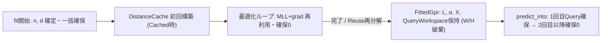

# cxxgpr 設計仕様書（Exact GPR）

本仕様書は、`gprx` の **Exact GPR** モデルを C++23 静的ライブラリ `cxxgpr` として移植するための要求（`REQ-01`〜`REQ-12`）および設計決定（`DES-01`〜`DES-20`）の正本である。永続化フォーマットの詳細は [docs/persist-format.md](persist-format.md)、モジュール間依存境界は [docs/architecture.md](architecture.md) が定める。

---

## 1. 製品要求（REQ-01 〜 REQ-12）

| ID | 題 | 要求内容 |
|---|---|---|
| REQ-01 | Exact GPR スコープ | `Gpr` / `FittedGpr`、全 10 組込みカーネル葉・`+`/`*` 合成・`Custom` 葉、供給二乗距離 `DistanceKernel`、前処理変換、`Double`/`Single`/`MixedPrecision`、`KernelExp`、5 種最適化器、`persist` を完全移植する。`Sgpr`/`Svgp`/`OnlineGpr` および誘導点座標微分は対象外とする |
| REQ-02 | C++23 非例外・値返却 API | API 境界へ例外を送出せず `[[nodiscard]] std::expected<T, GprError>` を返す。`Gpr::fit(...)` と `Gpr::factor(...)` は `const` メンバとし、失敗時に `*this` および出力引数を変更しない |
| REQ-03 | 列優先入力と入力検査順序 | 行列入力は列優先 `std::span<const double>`（`x`, `n_rows`, `n_cols`）とする。空入力、寸法オーバーフロー、配列長不一致、次元不一致、非有限（`NaN`/`±∞`）、データ不足を決定順序で検出し `GprError` を返す |
| REQ-04 | カーネル体系と合成 | 10 種の組込みカーネル葉（RBF・Matérn・RQ の各 Isotropic/ARD、Periodic、Constant、Linear、White）、`+`/`*` 平坦化合成、`Custom` 葉（`KernelTerm<T>`）、深さ優先左→右の $\theta$ 束縛を提供する |
| REQ-05 | 供給二乗距離 | `ScalarDistance` / `ArdDistance` / `DistanceKernel<DistanceOnly | WithPoints>` を提供し、`tidy(rel_tol)`・厳格検証・スロット誤用検出を備える。同条件の `Cached` 座標モデルより遅く、多く確保しない |
| REQ-06 | ノイズと Jitter の分離 | 対数観測ノイズ $\theta_{\text{noise}} = \log(\sigma_n^2)$ と数値安定化 `JitterPolicy`（`Fixed`/`Adaptive`）を分離する。初回は常に $j=0$ で試行し、失敗時のみ再試行し、採用された `factor_jitter` を保持・保存する |
| REQ-07 | 3 種精度ポリシーと IR | `DoublePrecision`、`SinglePrecision`、`MixedPrecision<PromoteStorage | ReevaluateKernel>` を提供し、`MixedPrecision` では `f32` Cholesky 因子上で `f64` 残差反復改良により $\alpha$ を精緻化する（不収束時は `f64` で解き直す） |
| REQ-08 | MLL・微分・LOO | 負の周辺対数尤度（MLL）、単一パス解析勾配、解析ヘッセ行列、GPML §5.4.2 の Leave-One-Out 推論を厳密式に従って実装する |
| REQ-09 | 自前最適化器群 | 外部ソルバに頼らず `Lbfgs`（Moré–Thuente）・`NelderMead`・`TrustRegion`（Steihaug–Toint CG）・`FastSimulatedAnnealing`（Cauchy/Metropolis/Ingber + 増分評価）・`Fixed`・logit 区間変換・決定的リスタートを自前実装する |
| REQ-10 | 前処理パイプライン | `Identity`・`Standardize`・`MinMax`・`Pipeline`・`ColumnwiseInput`・`TargetPipeline`・カスタム変換を提供し、予測平均・分散・共分散を閉じたアフィン逆変換で元尺度へ戻す |
| REQ-11 | ゼロ確保・決定的並列・境界 | ホットパス（MLL+grad、ウォームアップ後 `predict_into`）は新規確保 0。OpenMP 並列はスレッド数非依存でビット一致を保つ。`include/cxxgpr/` に Eigen・`nlohmann/json`・OpenMP を露出させない |
| REQ-12 | 永続化・乱数・独立検証 | `config.json` + `model.safetensors` 保存・`mmap` 読込・`PersistRegistry` を備え、`Xoshiro256++` で決定的標本抽出を行い、解析解および凍結済み `gprx` 出力と数値照合する |

---

## 2. アーキテクチャと型契約（DES-01 〜 DES-02）

### DES-01 型設計・生成契約・公開境界

公開名前空間は `cxxgpr` とし、下位に `cxxgpr::kernel`・`cxxgpr::transform`・`cxxgpr::persist` を置く（詳細型は `cxxgpr::detail`）。公開ヘッダは `include/cxxgpr/<module>/` に配置し、`<Eigen/...>`・`<nlohmann/...>`・`<omp.h>` を一切 `#include` しない（[architecture.md](architecture.md)）。

1. **構築と検証の分離**：
   - 検証で失敗し得ない型（`Gpr`, `Lbfgs`, `NelderMead`, `TrustRegion`, `FastSimulatedAnnealing`, `Fixed`, `IdentityInput`, `StandardizeInput`, `MinMaxInput` 等の既定値構成、空でないデフォルト設定）は通常のコンストラクタで構築する。
   - 入力範囲や制約で失敗し得る型（`RbfKernel`, `RbfArdKernel`, `MaternKernel`, `MaternArdKernel`, `PeriodicKernel`, `RationalQuadraticKernel`, `RationalQuadraticArdKernel`, `ConstantKernel`, `LinearKernel`, `WhiteKernel`, `GaussianLikelihood`, `Interval`, `JitterPolicy::fixed/adaptive`, `MinMaxInput::create(lo, hi)` 等）はコンストラクタを非公開とし、`[[nodiscard]] static std::expected<T, GprError> create(...)` ファクトリのみを公開する。
2. **未学習と学習済みの型分離**：
   - 未学習トレーナー `Gpr<O, P, K>` は `predict`・`loo_predict`・`save` を持たない。
   - `fit(...)` と `factor(...)`（`O = Fixed` 時または固定分解ファクトリ）はともに **`const` メンバ関数** とし、`[[nodiscard]] std::expected<FittedGpr<O, P, K>, GprError>` を返す。失敗時、`*this` は一切書き換わらない。
   - 前処理も同様に `UnfittedInputTransform` / `FittedInputTransform` および `UnfittedTargetTransform` / `FittedTargetTransform` に型を分ける。未学習の `apply` / `transform` は型として呼び出せない。
3. **拡張可能列挙と閉じた列挙**：
   - 将来拡張し得る `GprError` のエラー分類や拡張タグを網羅するコードは未知値への既定分岐を想定する一方、`Triangle`（`Lower`, `Upper`, `Full`）、`MaternNu`（`Nu1_2`, `Nu3_2`, `Nu5_2`）、`VarianceKind`（`Latent`, `Observation`）、`CholeskyBuffer`（`Retain`, `Reuse`）は閉じた列挙型とする。

### DES-02 エラー型 `GprError` と入力検査契約

`NotFitted` は置かない。数値計算・入力・永続化の失敗は全て値型 `GprError` として返す。

| エラーコード（`GprErrorCode`） | 主な発生条件・付帯情報 |
|---|---|
| `EmptyInput` | $n = 0$ または $d = 0$（`DistanceOnly` を除く）、空の長さスケール配列 |
| `SizeOverflow` | `n_rows * n_cols` または $n(n+1)/2$ 等のサイズ積が `std::size_t` 上限を超える |
| `LengthMismatch` | `x.size() != n_rows * n_cols`、`y.size() != n_rows`、`out.size() != p` 等 |
| `DimensionMismatch` | 予測・クエリや変換適用時の特徴量数 $d$ の不一致 |
| `IndexOutOfRange` | パラメータ索引 `i >= p` または増分更新で指定外座標が変化した |
| `InsufficientData` | $n$ がカーネル／モデルの最小点数未満（Exact GPR では原則 $n \ge 1$、LOO 等・特殊要件含む） |
| `NonFiniteInput` | `x`、`y`、パラメータ $\theta$、設定浮動小数点値の `NaN` / `±∞` |
| `NonFiniteKernelValue` | カーネル評価値が非有限になった |
| `InvalidHyperparameter` | $\ell, \sigma^2, \alpha, p$ 等の領域違反（非正・非有限・区間外） |
| `InvalidNoiseVariance` | `GaussianLikelihood` の $\sigma_n^2 \le 0$ または非有限 |
| `InvalidInterval` | `Interval` の下限 $\ge$ 上限、非正（正値区間時）、非有限 |
| `InvalidConfig` | 最適化器設定値、Jitter 設定、`tidy` 許容差、`ColumnwiseInput` 構成不正 |
| `InvalidDistance` | 供給二乗距離の非有限・負値・対角非零・対称違反（`slot`, `dim`, `pair`, `reason`） |
| `DistanceSlot` | スロット不足・重複・未知スロット（`SlotErrorKind`, `slot`） |
| `UnsupportedKernelOperation` | 別カーネル用の供給源を渡す、`DistanceOnly` カーネルでの座標操作など |
| `CholeskyFailed` | Cholesky 分解失敗（試みた最後の `jitter`、`matrix_size`、`CholeskyStage::{Fit, Predict}`） |
| `NonPositiveDefiniteMatrix` | 正定値性を満たさない行列に対する失敗 |
| `OptimizationNotConverged` | 反復上限や線探索破綻による最適化未収束（経過 `iterations`） |
| `WorkspaceTooSmall` | 外部・事前確保バッファ不足 |
| `PersistFailed` | I/O・JSON 構成・テンソル検査・誤モデル・ID 未登録等の永続化エラー（`PersistErrorKind`） |
| `UnsupportedPersistVersion` | `format_version != 1`（`found`, `supported`） |

**検査順序の原則**：複数の検証違反が同時に成立する場合は、次の厳密な全順序で最初に該当した `GprError` を返す。
`EmptyInput`（$n = 0$、座標モデルの $d = 0$、空スライス・空配列）→ `SizeOverflow`（`n_rows * n_cols` や $n(n+1)/2$ 等の `std::size_t` 乗算オーバーフロー）→ `LengthMismatch`（`x.size() != n_rows * n_cols`、`y.size() != n_rows`、出力スライス長不一致）→ `DimensionMismatch`（学習済みモデル・前処理変換・ARD カーネルが期待する特徴量次元 $d$ と入力列数 `n_cols` の不一致）→ `NonFiniteInput`（`x`, `y`, $\theta$ 等の `NaN` / `±∞`）→ `InsufficientData`（処理に必要な最小サンプル数未満）。IEEE 754 非正規化数（subnormal）は有効な有限値としてそのまま処理し、MXCSR / FPCR を操作しない。

---

## 3. 線形代数・ノイズ・Jitter・精度（DES-03 〜 DES-05）

### DES-03 線形代数バックエンド（Eigen + OpenMP）

内部線形代数には vcpkg で固定した Eigen 5.0.1（`EIGEN_MPL2_ONLY` + `EIGEN_DONT_PARALLELIZE`）を使用する。

- **格納順**：全密行列は列優先（Column-major：`Eigen::Matrix<S, Eigen::Dynamic, Eigen::Dynamic, Eigen::ColMajor>`）。入力データ `x`（$n \times d$）およびカーネル行列・因子 $L$ は列優先で保持する。
- **Cholesky 分解**：`uplo = Lower` だけを構築・参照し、`Eigen::LLT<..., Eigen::Lower>` で in-place 相当の事前確保バッファ上で分解を行う（`matrixL()` 使用）。
- **確保検知**：`EIGEN_RUNTIME_NO_MALLOC` を用い、テスト用監査スコープ `AllocationAudit` 内で `Eigen::internal::set_is_malloc_allowed(false)` と標準ヒープ確保フックを併用し、ホットパス確保ゼロを機械的に強制する。
- **浮動小数点厳格性**：MSVC `/fp:strict`、GCC/Clang `-ffp-contract=off -fno-fast-math` を課し、コンパイラ再結合・暗黙 FMA を防ぐ。

### DES-04 観測ノイズ `GaussianLikelihood` と `JitterPolicy`

観測ノイズ $\sigma_n^2$ と数値正則化 jitter $j$ を明確に分離する。

- **`GaussianLikelihood`**：対数空間 $\theta_{\text{noise}} = \log(\sigma_n^2)$ を `Interval`（既定 `(1e-5, 1e5)`）上に保持する具体クラス。$\sigma_n^2 = \exp(\theta_{\text{noise}})$ であるため $\partial K / \partial \theta_{\text{noise}} = \sigma_n^2 I$ となる。
- **`JitterPolicy`**：`Fixed`（既定：$j = 0.0$、失敗時再試行 1 回または $j=0$ で即終了）と `Adaptive(initial, multiplier, max_retries, max_jitter)` を取る。
- **再試行アルゴリズム**：
  1. 常に $j = 0$ で $A = K + \sigma_n^2 I$ の下三角 Cholesky 分解を試す。
  2. 成功すれば `factor_jitter = 0.0` とする。
  3. 失敗時のみ `JitterPolicy` に従い、`Fixed(j)` は $j > 0$ で 1 回のみ再試行し、`Adaptive` は `initial` から毎回 `multiplier` 倍しながら `max_retries` 回以内かつ $j \le \text{max\_jitter}$ の範囲で $(A + jI)$ の分解を再試行する。
  4. 成功した最終 $j$ を `factor_jitter` に記録・永続化し、事後の $\alpha$ 解および `MixedPrecision` 反復改良も一貫して同じ系 $(A + jI)$ 上で行う（jitter 付き因子に対して $A$ へ戻す反復改良は行わない）。

### DES-05 精度ポリシーと混合精度反復改良（IR）

```cpp
struct PromoteStorage {};    // residual r = y_f64 - cast_f64(A_f32) * alpha
struct ReevaluateKernel {};  // residual r = y_f64 - kernel_f64(X) * alpha (blocked O(n) buffer)

struct DoublePrecision { using Storage = double; using Refine = double; };
struct SinglePrecision { using Storage = float;  using Refine = float;  };
template <typename ResidualFormula = PromoteStorage>
struct MixedPrecision  { using Storage = float;  using Refine = double; using Residual = ResidualFormula; };
```

- **`DoublePrecision`**：格納・演算・推論すべて `double`（既定）。
- **`SinglePrecision`**：格納・演算・推論すべて `float`。反復改良なし。
- **`MixedPrecision<R>`**：`K + σn²I + jI` を `float`（$u_f \approx 1.19 \times 10^{-7}$）で分解・格納し、予測ウェイト $\alpha$ のみを `double` 残差で反復改良する。学習ループ中の MLL・解析勾配は `float` 因子をそのまま使用する。
- **記号定義**：$B = A + (\sigma_n^2 + j)I$（採用された jitter $j \ge 0$ を含む訓練系行列）、$w_k = \alpha^{(k)} \in \mathbb{R}^n$（第 $k$ 反復の重み近似解）、$b = y \in \mathbb{R}^n$（変換後目的変数ベクトル）、$r_k = b - B w_k$（`double` で評価した残差ベクトル）、$\|\cdot\|_\infty$ はベクトルの最大絶対値ノルム（$\|v\|_\infty = \max_i |v_i|$）および行列の最大行絶対値和ノルム（$\|B\|_\infty = \max_i \sum_j |B_{ij}|$）、$\varepsilon_{64} = 2^{-52} \approx 2.220446049250313 \times 10^{-16}$（`std::numeric_limits<double>::epsilon()`、`gprx` の `f64::EPSILON` と同一）とし、停止閾値を $\text{tol} = 10 \cdot n \cdot \varepsilon_{64}$ と定める。
- **反復改良パラメータと停止・フォールバック契約**（内部定数固定）：
  - 最大補正反復回数：`10`
  - 収束条件：分母 $\|B\|_\infty \|w_k\|_\infty + \|b\|_\infty > 0$ かつ $\|r_k\|_\infty / (\|B\|_\infty \|w_k\|_\infty + \|b\|_\infty) < 10 \cdot n \cdot \varepsilon_{64}$
  - 停滞打切り：残差ノルム比 $\|r_k\|_\infty / \|r_{k-1}\|_\infty > 0.9$ が 2 回連続
  - `PromoteStorage` の収束後検証：`PromoteStorage` で収束判定を満たした解 $w$ に対し、真の `f64` カーネル行列による系 $B_{\text{f64}} = K_{\text{f64}}(X) + (\sigma_n^2 + j)I$ を列ブロック（ブロック幅 32、$n \times n$ の `f64` 行列全体は保持しない）で評価して真の残差 $r_{\text{f64}} = b - B_{\text{f64}} w$ と行和ノルム $\|B_{\text{f64}}\|_\infty$ を 1 回計算し、反復停止条件と同一の相対残差式
    $$\|r_{\text{f64}}\|_\infty / \left(\|B_{\text{f64}}\|_\infty \|w\|_\infty + \|b\|_\infty\right) < 10 \cdot n \cdot \varepsilon_{64}$$
    （かつ分母 $> 0$）を満たすか検査する。満たさない場合（$\kappa(A) u_{32}$ 過大等）、または IR が最大反復回数・停滞判定で収束しなかった場合は、**エラーを返さず、同じ $(A + (\sigma_n^2 + j)I)$ 系を `f64` Cholesky 分解で解き直す**。IR 不収束時に jitter を増やさない。

---

## 4. カーネル・距離キャッシュ・供給二乗距離（DES-06 〜 DES-12）

### DES-06 `KernelSpec`（宣言層）と `CompiledKernel<T>`（実行層）

`KernelSpec` は精度非依存に `double` でパラメータと木構造を保持し、演算子 `+`（和）と `*`（積）で構成する。`compile<T>()` が結合則に沿って `Sum` と `Product` を平坦化し、実行時静的ディスパッチ用の `CompiledKernel<T>`（`double` または `float`）へコンパイルする。

- **パラメータ束縛（`ParameterBinding`）**：モデル全体の最適化ベクトル $\theta$ は `[\text{kernel\_params} \mid \theta_{\text{noise}}]` の連結であり、カーネル部は深さ優先・左から右の葉順・葉内ローカル索引順で平坦割り当てする。
- **`set_params` の原子性**：部分葉で範囲外・非有限を検出した場合、変更済み葉を含め全葉の状態を変更前に保つ（失敗時不変）。
- **`CoordMode`**：コンパイル時に木全体を検査し、`Dist`（等方距離葉のみ）、`Points`（ARD/Linear 座標葉を含む）、`Either`（Constant/White のみ）、`Mixed`（距離葉と座標葉の複合）を分類する。
- **`nested_depth` とスクラッチ見積り**：木構造から必要な `n×n`（および予測時 `n×m`）中間バッファ枚数を事前計算し、ワークスペースから借用して木走査中の動的確保を 0 にする。

### DES-07 全 10 種組込みカーネル葉の数理定義と区間

すべての正値パラメータ $v > 0$ は対数表現 $\theta = \log(v)$ を最適化空間とし、既定区間は `Interval::DEFAULT_POSITIVE = (1e-5, 1e5)` とする。等方カーネルのユークリッド距離を $r = \|x - x'\|_2$、二乗距離を $d^2 = \|x - x'\|_2^2$、ARD スケール距離を $s^2 = \sum_{k=1}^d (x_k - x'_k)^2 / \ell_k^2$（$r_{\text{ard}} = \sqrt{s^2}$）と書く。

| カーネル葉クラス | 数式 $k(x, x')$ | 最適化パラメータ $\theta$ |
|---|---|---|
| `RbfKernel` | $\exp\!\left(-\frac{d^2}{2\ell^2}\right)$ | $[\log \ell]$ |
| `RbfArdKernel` | $\exp\!\left(-\frac{1}{2}\sum_k \frac{(x_k - x'_k)^2}{\ell_k^2}\right)$ | $[\log \ell_0, \dots, \log \ell_{d-1}]$ |
| `MaternKernel` ($\nu = 1/2$) | $\exp\!\left(-\frac{r}{\ell}\right)$ | $[\log \ell]$ |
| `MaternKernel` ($\nu = 3/2$) | $\left(1 + \frac{\sqrt{3}\,r}{\ell}\right)\exp\!\left(-\frac{\sqrt{3}\,r}{\ell}\right)$ | $[\log \ell]$ |
| `MaternKernel` ($\nu = 5/2$) | $\left(1 + \frac{\sqrt{5}\,r}{\ell} + \frac{5 r^2}{3\ell^2}\right)\exp\!\left(-\frac{\sqrt{5}\,r}{\ell}\right)$ | $[\log \ell]$ |
| `MaternArdKernel` | 上記と同じ $1/2, 3/2, 5/2$ 動径関数に $u = \sqrt{s^2}$ を適用 | $[\log \ell_0, \dots, \log \ell_{d-1}]$ |
| `PeriodicKernel` | $\exp\!\left(-\frac{2\sin^2(\pi r / p)}{\ell^2}\right)$ | $[\log \ell, \log p]$ |
| `RationalQuadraticKernel` | $\left(1 + \frac{d^2}{2\alpha\ell^2}\right)^{-\alpha}$ | $[\log \ell, \log \alpha]$ |
| `RationalQuadraticArdKernel` | $\left(1 + \frac{s^2}{2\alpha}\right)^{-\alpha}$ | $[\log \ell_0, \dots, \log \ell_{d-1}, \log \alpha]$ |
| `ConstantKernel` | $c$ | $[\log c]$ |
| `LinearKernel` | $\sigma^2 x^\top x'$ | $[\log \sigma^2]$ |
| `WhiteKernel` | $\sigma_w^2 \delta_{x, x'}$（学習 Gram 対角のみ非零、交差共分散 0） | $[\log \sigma_w^2]$ |

1 階微分 $\partial K / \partial \theta_i$ および 2 階微分 $\partial^2 K / \partial \theta_i \partial \theta_j$（二乗距離入力用 `hess` / 座標葉用 `hess_points`）を各葉について解析的に実装する。`Matern(Ard)` の $r=0$（対角および重複点）における 1・2 階微分は連続極限値 $0$ とし、ゼロ除算を起こさない。

### DES-08 ユーザー定義カーネル拡張 `KernelTerm<T>`

ユーザーカスタム葉は二乗距離行列 `dist`（または距離ブロック）から評価される葉インターフェースとして定義し、仮想基底クラス `KernelTerm<float>` および `KernelTerm<double>`（共通クラステンプレートまたは型消去ラッパ経由）で受け入れる。座標モデルで使用する場合も `cxxgpr` 側が座標 `x` から二乗距離行列 `dist` を計算（または距離キャッシュから供給）したうえで `apply`・`apply_cross`・`grad`・`hess` を呼び出す。Eigen 型を公開ヘッダに出さないため、距離・出力行列は軽量ビュー `MatrixRef<T>` / `MatrixMut<T>`（`data()`, `rows()`, `cols()`, `col_stride()`）として渡す。

```cpp
// Public concept / interface signature overview (no Eigen headers)
template <typename T>
class KernelTerm {
public:
    virtual ~KernelTerm() = default;
    virtual std::size_t num_params() const = 0;
    virtual std::expected<void, GprError> get_params(std::span<double> out) const = 0;
    virtual std::expected<void, GprError> set_params(std::span<const double> params) = 0;
    virtual std::expected<void, GprError> bounds_into(std::span<Interval> out) const = 0;
    virtual std::expected<void, GprError> apply(MatrixRef<T> dist, MatrixMut<T> out, Triangle uplo) const = 0;
    virtual std::expected<void, GprError> apply_cross(MatrixRef<T> dist, MatrixMut<T> out) const = 0;
    virtual std::expected<void, GprError> fill_diag(std::span<T> out) const = 0;
    virtual std::expected<void, GprError> grad(MatrixRef<T> dist, MatrixMut<T> d_k, std::size_t param_idx, Triangle uplo) const = 0;
    virtual std::expected<void, GprError> hess(MatrixRef<T> dist, MatrixMut<T> d2_k, std::size_t i, std::size_t j, Triangle uplo) const = 0;
    virtual std::string_view persist_id() const { return ""; }
    virtual std::expected<std::string, GprError> persist_state_json() const;
};
```

組み込みカーネルの葉はホットパスで `std::variant` / `enum` 静的ディスパッチし、動的ディスパッチは `Custom` 葉のみに限定する。

### DES-09 距離キャッシュ方針（`DistanceCachePolicy`）

`DistanceCachePolicy::{Cached, Uncached}` を実行時列挙で保持する（既定は `Cached`）。

- **`Cached`**：`fit`/`factor` 開始時に訓練点間の二乗ユークリッド距離（密な $n \times n$ 列優先行列、等方葉用）および次元ごと生差分二乗 $(\Delta x_m)^2$（長さ $\text{dims} \cdot n(n+1)/2$ の連続配列上で次元 $m \in [0, \text{dims})$ のブロックを順に並べ、各ブロック内の下三角要素 $(i \ge j)$ を列優先パック位置 $p = jn - j(j-1)/2 + (i - j)$、すなわちフラット添字 `m * (n*(n+1)/2) + p` に格納、ARD 葉用）を 1 度だけ計算・保持し、最適化中の全反復で再利用する。コンパイル済みカーネルが距離・ARD キャッシュを読まない（例：単独 `Constant` / `Linear` / `White`）場合は一切確保しない。
- **`Uncached`**：これら中間距離バッファを確保せず、各評価時に座標 `X` から直接計算する。

### DES-10 供給二乗距離（`ScalarDistance` / `ArdDistance` / `DistanceKernel<C>`）

座標の代わりに呼び出し側が計算した二乗距離表（測地距離、グラフ距離等）からカーネルを評価する。

- **スロットと型マーカー**：
  - `ScalarDistance`（各点の組につきスカラー $d^2$ 1 個）と `ArdDistance(dims)`（各組・次元ごとに $d^2$ 1 個）を宣言し、カーネル葉を束ねて `DistanceKernel<DistanceOnly>` または座標葉との混成 `DistanceKernel<WithPoints>` を構成する。
  - 各スロットは深さ優先順で一意の slot ID（および同種内の番号）を持ち、別カーネルのスロット供給を渡した場合は `GprError::UnsupportedKernelOperation` を返す。スロットの不足・重複は `DistanceSlot` とする。
- **表の検査と `tidy(rel_tol)`**：
  - 供給 `DistanceSource` は訓練時に $n \times n$ 対称・非負・有限・対角 $0$ であることを 1 パス（$O(n^2)$）で検証する。既定では微小な負値や鏡像不一致を暗黙修正せず `InvalidDistance` を返す（最初に失敗した `(row, col)`・次元・スロットを記録）。
  - 呼び出し側が `source.tidy(rel_tol)` を明示有効化した供給に限り、`rel_tol` 範囲内の対角・負値を $0$ に、鏡像ペア $(i, j),(j, i)$ を平均値へ修復し、許容超過時は最悪ペアで `InvalidDistance` を返す。
  - ARD 供給を `Cached` または内部保持へ取り込む際は検査と下三角パッキングを同時に 1 パスで行い、余分な密 `d · n²` 一時コピーを作らない。`fill` インタフェースも列ブロック再帰バッファ経由で下三角へ直接詰める。
- **性能保証**：同一 $n, d$・精度・カーネルの座標 `Cached` モデルに対し、時間・確保数ともに上回ってはならない。

### DES-11 増分更新対応（`LeafCache` と `USES_CHANGE_INDICES`）

`OptimizerTraits<O>::uses_change_indices`（`FastSimulatedAnnealing` で `true`、他で `false`）かつ `CholeskyBuffer::Retain` のとき、`GprObjective` は直前の $\theta$ と各葉ごとの Gram 行列を `LeafCache<S>` に保持する。

- `value_at_changes(params, indices)` が呼ばれた際、まず渡された `params` と直前 `theta` の各成分を `std::bit_cast<std::uint64_t>` でビット比較し、`indices` 外の成分が変わっていれば即座に `GprError::IndexOutOfRange` を返す（重複・範囲外索引も同様）。
- 変化した索引が影響するカーネル葉だけ `apply` を再計算して木の和・積を再構成する。Cholesky 分解は低ランクではないため毎回 $O(n^3)$ でやり直す。`CholeskyBuffer::Reuse` 時は部分更新を行わず全体を再構築する。

### DES-12 指数評価バックエンド `KernelExp`

`KernelExp::{Accurate, FastApprox}` を実行時選択として各モデルへ保持する（既定は `Accurate`）。

- `Accurate`：`std::exp`（格納型 `float`/`double`）をそのまま使用する。
- `FastApprox`：カーネル評価中の $\exp(-x)$ 計算を、範囲還元 $x = k \ln 2 + f$ と格納型上の 7 次ミニマックス多項式近似で置き換える（`exp(θ)` による長さスケール復元や `Custom` 葉内の演算には使わない）。

---

## 5. Exact GPR 数理算法・バッファ・推論（DES-13 〜 DES-17）

### DES-13 MLL と解析勾配の単一パス算法（`keep_plan`）

負の周辺対数尤度（最小化対象）と勾配は次の式で定義する（$A = K + \sigma_n^2 I = L L^\top$、$\alpha = A^{-1} y$、$W = \alpha \alpha^\top - A^{-1}$）：

$$
\mathcal{L}(\theta) = \frac{1}{2} y^\top A^{-1} y + \frac{1}{2} \log |A| + \frac{n}{2} \log(2\pi), \qquad
\log |A| = 2 \sum_{i=0}^{n-1} \log L_{ii}
$$

$$
\frac{\partial \mathcal{L}}{\partial \theta_i} = -\frac{1}{2} \alpha^\top \frac{\partial A}{\partial \theta_i} \alpha + \frac{1}{2} \operatorname{Tr}\!\left(A^{-1} \frac{\partial A}{\partial \theta_i}\right) = -\frac{1}{2} \langle W, \frac{\partial A}{\partial \theta_i} \rangle_F
$$

`value_and_gradient_into` は次の手順を 1 パスで実行する（全体コスト $O(n^3 + p n^2)$）：

1. `k_matrix` の下三角に $A = K + \sigma_n^2 I$ を構築する。定数因子を除く複数因子積（$A \times B$）で勾配計算に有利な場合は `keep_plan` に従って中間因子 Gram を予約バッファへ残す。
2. `k_matrix` 上で in-place 下三角 Cholesky 分解（失敗時は `JitterPolicy` に従い $A + jI$ で再試行）を行い、$L$ を得る。
3. 対角から $\log |A|$、前後退代入で $\alpha$ を求める。
4. `W = ααᵀ - A⁻¹` を下三角のみ構築する（`Retain` は専用 `w_matrix`、`Reuse` は `exp_buf` 経由で `k_matrix` へ上書き）。
5. `CompiledKernel::weighted_grads` で木を 1 回走査し、和はそのまま・積は他因子の積を重みに掛けて各葉の $\langle W_{\text{eff}}, \partial K/\partial \theta_i \rangle_F$ を計算する。`GaussianLikelihood` の勾配は対角和のみ（$\sigma_n^2 \sum_k W_{kk}$）から得る。Frobenius 内積の総和は並列評価後に列番号順へ決定的に畳み込む。

### DES-14 解析ヘッセ行列（`HessianScratch`）

$$
H_{ij} = \frac{\partial^2 \mathcal{L}}{\partial \theta_i \partial \theta_j}
= -\frac{1}{2} \langle W, \frac{\partial^2 A}{\partial \theta_i \partial \theta_j} \rangle_F
  - \frac{1}{2} \operatorname{Tr}\!\left(A^{-1} A_i A^{-1} A_j\right)
  + \alpha^\top A_i A^{-1} A_j \alpha
$$

ここで $A_i = \partial A / \partial \theta_i$、$S_i = L^{-1} A_i L^{-\top}$、$v_i = L^{-1} A_i \alpha$ とおくと、$\operatorname{Tr}(A^{-1} A_i A^{-1} A_j) = \langle S_i, S_j \rangle_F$、$\alpha^\top A_i A^{-1} A_j \alpha = v_i^\top v_j$ が得られ、全体 $O(p n^3 + p^2 n^2)$ で解析ヘッセ行列（列優先 / 対称 $p \times p$）を算出する。`HessianScratch`（$p$ 枚の $n\times n$ 行列 $S_i$ と $n \times p$ 行列 $v$）は `WorkspaceCore` 内で最初の呼び出しまで空とし、2 回目以降は再利用して追加確保しない。

### DES-15 `CholeskyBuffer::{Retain, Reuse}` とメモリ・速度優先

- **速度優先（`with_prefer_speed()`、既定）**：`DistanceCachePolicy::Cached` + `CholeskyBuffer::Retain`。$L$ と $W$ を別バッファに保ち、不要な再分解を省く。
- **メモリ優先（`with_prefer_memory()`）**：`DistanceCachePolicy::Uncached` + `CholeskyBuffer::Reuse`。`w_matrix` を持たず $W$ を `k_matrix` へ上書きし、`fit` 完了時と単独 `value_and_gradient_into` / `hessian_into` 終了時に $L$ を再分解して整合を戻す。永続化時は常に `Retain` 相当として読み込む。

### DES-16 推論 API・共分散・標本抽出・LOO

学習済みモデル `FittedGpr<O, P, K>` は `L`・`factor_alpha`・`alpha`・`X`・カーネル・尤度・前処理を保持し、次の操作を提供する（出力スカラー型は `P::Refine`）：

- `predict(xs, n_rows, n_cols)` / `predict_with(xs, n_rows, n_cols, PredictOptions)`：平均 $\mu_* = K_*^\top \alpha$、分散 $v_* = \operatorname{diag}(K_{**}) - \|L^{-1} K_*\|_2^2$（`VarianceKind::Observation` なら $+\,\sigma_n^2$ を加算、`Latent` は加算しない）。最後に `TargetTransform` で平均と分散（$s^2$ 倍）を逆変換して返す。
- `predict_into(..., Prediction<Refine>& out)` / `predict_with_into(...)`：同じクエリ形状 $(m, d)$ での 2 回目以降の呼び出しで、`QueryWorkspace` と出力 `mean`/`variance` 容量を再利用し **新規確保 0** を達成する。
- `predict_covariance` / `predict_covariance_with`：完全な事後共分散行列 $\Sigma_* = K_{**} - (L^{-1} K_*)^\top (L^{-1} K_*)$（列優先 $m \times m$、`Observation` 時は対角に $\sigma_n^2$ 加算）を返す。
- `sample(xs, n_rows, n_cols, n_draws, seed)` / `sample_with`：対称化した事後共分散に数値微小ジッタを伴う Cholesky 因子を求め、`Xoshiro256++` + Box–Muller 標準正規乱数から $n_{\text{draws}}$ 本（長さ $n_{\text{draws}} \cdot m$）の事後標本を生成する。
- `loo_predict()` / `loo_predict_with()`（GPML §5.4.2 閉じた式）：$Q_{ii} = (A^{-1})_{ii} = \|L^{-1} e_i\|_2^2$ および `TargetTransform` 適用後の訓練目的変数 $\tilde{y}_i$ を用い、変換後空間で $\tilde{\mu}_{\text{LOO}, i}$ と $\tilde{\sigma}_{\text{LOO}, i}^2$ を計算した**後に** `TargetTransform` の閉じたアフィン逆変換（平均の逆変換および分散の $s^2$ 倍）を適用して元尺度の `Prediction<T>` を返す：

$$
\tilde{\mu}_{\text{LOO}, i} = \tilde{y}_i - \frac{\alpha_i}{Q_{ii}}, \qquad
\tilde{\sigma}_{\text{LOO}, \text{obs}, i}^2 = \frac{1}{Q_{ii}}, \qquad
\tilde{\sigma}_{\text{LOO}, \text{lat}, i}^2 = \max\!\left(0,\; \frac{1}{Q_{ii}} - \sigma_n^2\right)
$$

### DES-17 ワークスペース構造とライフサイクル



- `WorkspaceCore<P>`：`k_matrix`、`exp_buf`、`kernel_scratch`、`thread_scratch`（OpenMP スレッド別スクラッチ）、`rhs`、`theta` バックアップ、`nested`、`hessian`、`factor_jitter`。
- `FitBuffers<P>`：`WorkspaceCore<P>` + `dist`（optional `DistCache`） + `w_matrix`（optional `Retain` 時）。`fit` 終了時に解放し `FittedGpr` に残さない。
- `QueryWorkspace<P>`：`FittedGpr` に属し、クエリ変換・距離・`k_star`・`k_ss`・入れ子スクラッチを保持する。

---

## 6. 前処理・最適化器・乱数・並列（DES-18 〜 DES-20）

### DES-18 前処理クラス階層（`cxxgpr::transform`）

全ての前処理は `double` で適用する（精度ポリシー非依存）。

- **入力変換（`UnfittedInputTransform` / `FittedInputTransform`）**：`IdentityInput`（既定）、`StandardizeInput`（ゼロ分散列の扱い規約一致）、`MinMaxInput`（既定範囲 `[0, 1]`、`create(lo, hi)`）、`Pipeline`（直列結合）、`ColumnwiseInput`（特徴量ごと個別変換指定、`maps.size() == d` 検査）、ユーザーカスタム基底。すべて逆変換 `inverse_apply` を備える。
- **目的変数変換（`UnfittedTargetTransform` / `FittedTargetTransform`）**：`IdentityTarget`（既定）、`StandardizeTarget`、`MinMaxTarget`、`TargetPipeline`、ユーザーカスタム基底。分散・共分散の逆変換はアフィン尺度 $s^2$ 倍を行う。

### DES-19 自前最適化器群（`cxxgpr::optimizer`）

目的関数抽象は `Objective`（`value`, `value_at_changes`, `fill_intervals`）$\subset$ `Differentiable`（`gradient_into`, `value_and_gradient_into`）$\subset$ `TwiceDifferentiable`（`hessian_into`）の 3 階層とする。

- **区間写像（logit 変換）**：`Lbfgs`・`NelderMead`・`TrustRegion` は各パラメータの正値開区間 $(a, b)$ 上で対数変換済み $\theta \in (\log a, \log b)$ を無制約空間 $z \in \mathbb{R}$ へロジット写像し（中点でヤコビアン $1$ スケーリング）、`TrustRegion` にはヘッセ行列のチェインルール変換も含めて渡す。
- **各アルゴリズムの仕様（既定値 `max_iterations = 100`, `tolerance = sqrt(eps)`）**：
  - `Lbfgs`：Hestenes/Nocedal 2-loop 再帰（既定 `history_size = 10`）＋ **Moré–Thuente 線探索**。評価共有 `EvalCache` を持つ。
  - `TrustRegion`：解析ヘッセ行列と **Steihaug–Toint 共役勾配部分問題**（`initial_radius = 1.0`, `max_radius = 100.0`）。不定値・特異ヘッセ行列や境界外試行時は信頼領域半径の縮小で吸収する。
  - `NelderMead`：標準反射・拡張・収縮・縮小単体法（`Objective` のみ使用）。
  - `FastSimulatedAnnealing`：log-$\theta$ 空間を直接探索し（logit 不使用）、Cauchy 提案・Metropolis 採択・Ingber 指数冷却（既定 `initial_temperature = 1.0`, `cooling_rate = 3.0`, `seed = 0`, `BoundaryPolicy::Clamp | Reflect`）と 1 座標変更時 `value_at_changes` による増分更新を用いる。
  - `Fixed`：`Gpr<Fixed>` の `factor()` 専用マーカー（最適化反復なし）。
- **`with_restarts(n, seed)`**：初回探索点に加え、`Xoshiro256++` により区間内対数一様（logit 空間対応）で決定的に生成した追加 $n$ 点から探索し、最小値および対応パラメータを返す。

### DES-20 決定的乱数（`Xoshiro256++`）とスレッド不変 OpenMP 並列

- **`Xoshiro256++`**：全 `seed` を SplitMix64 で 256-bit 状態へ展開し、`next_u64()` / 統一 $[0, 1)$ `double` / Box–Muller 標準正規乱数を生成する。同一シードに対する出力列は OS（Windows / Linux）・ビルド設定間で厳密一致する（`gprx` `src/rng.rs` と完全互換）。
- **OpenMP 並列設計**：
  - Gram 下三角列ブロックは各ワーカーの担当領域面積が均等になる分割（`lower_block_start`）で OpenMP 並列化する。
  - `weighted_grads` などの総和は「ワーカー別・列別部分和を計算 → **列番号昇順で逐次加算**」とし、OpenMP スレッド数（1 vs 任意スレッド）を問わず **ビット単位で同一** の浮動小数点結果を保証する。
