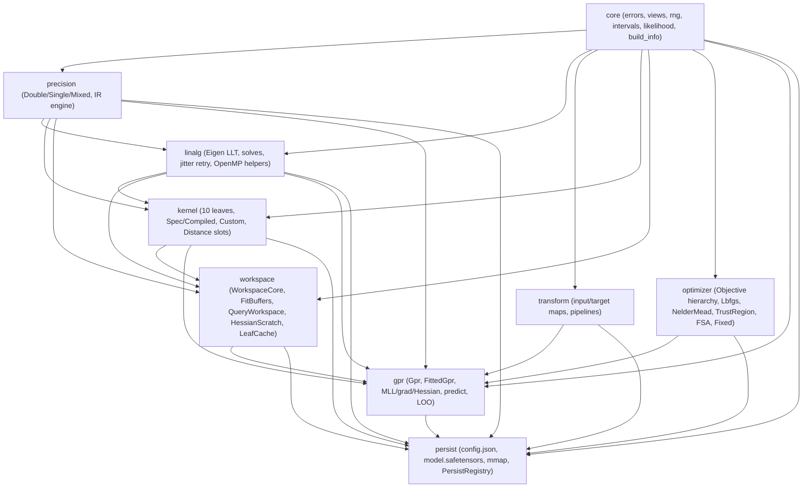

# Architecture and module dependency boundaries

This document defines the layered structure of `cxxgpr` and the permitted dependency directions between modules. The static architecture check introduced in M0-2 (`just arch-check` / `tools/qa/arch_check.py`) treats the table below as the canonical source and verifies the `#include` graph against it.

## Layer diagram

An arrow `A --> B` means "B may depend on A". The graph is a DAG; cycles and reverse references are forbidden.

## Permitted dependency matrix

`tools/qa/arch_check.py` reads the `ARCH-MODULE-DEPS` table below and checks that every public and internal `#include "cxxgpr/<dep>/..."` of each module is within its permitted set.

| Module | Permitted direct dependencies | Description |
|---|---|---|
| `core` | (none) | Lowest layer. Error types, view types, checked arithmetic, random numbers, `GaussianLikelihood`, build information |
| `precision` | `core` | Precision policy tags and the iterative-refinement convergence test |
| `linalg` | `core`, `precision` | Eigen dense Cholesky factorization, triangular solves, the Jitter loop, OpenMP helpers |
| `transform` | `core` | Pre-fit and post-fit transforms for inputs and targets, and custom bases |
| `kernel` | `core`, `precision`, `linalg` | Kernel specifications, compiled trees, supplied squared-distance slots, `KernelTerm<T>` |
| `workspace` | `core`, `precision`, `linalg`, `kernel` | Pre-allocated buffers, distance caches, Hessian scratch, leaf caches |
| `optimizer` | `core` | Objective interface, logit transform, the optimization solvers |
| `gpr` | `core`, `precision`, `linalg`, `transform`, `kernel`, `workspace`, `optimizer` | Exact GPR fitting, prediction, NLML, gradient, Hessian, and LOO integration |
| `persist` | `core`, `precision`, `linalg`, `transform`, `kernel`, `workspace`, `optimizer`, `gpr` | Model serialization and deserialization, and `mmap` loading |

## Third-party header isolation boundaries

A file that violates any of the following boundaries fails `just arch-check` immediately.

1. **Public-header non-exposure boundary (`include/cxxgpr/**`)**:
   - Must not `#include` `<Eigen/...>` or types that depend on Eigen-related macros.
   - Must not `#include` external BLAS/LAPACK headers (`<cblas.h>`, `<openblas/...>`, `<mkl...>`).
   - Must not `#include` `<nlohmann/...>`. User-defined persistent state goes through a lightweight JSON string or a dedicated abstraction, and `nlohmann::json` types never appear in the public API.
   - Must not `#include` `<omp.h>`.
   - Must not `#include` non-public headers under `detail/` or files on the `src/` side.
2. **Internal implementation layer (`src/<module>/**`)**:
   - Only the implementation `.cpp` files of `linalg`, `kernel`, `workspace`, and `gpr` (and private headers inside `src/`) may use Eigen (`EIGEN_MPL2_ONLY` + `EIGEN_DONT_PARALLELIZE`) and OpenMP. The one exception is `src/core/build_info.cpp`, which may reference the `<Eigen/Core>` version macros to collect dependency version strings for `QA-06`.
   - Only the implementation `.cpp` files of `linalg` (specifically `src/linalg/blas_backend.cpp`) may include `<cblas.h>` / `<mkl.h>` / `<mkl_*.h>`, with `src/core/build_info.cpp` permitted to read BLAS/MKL version macros for `QA-06`.
   - Only the implementation `.cpp` files of `persist` (and private headers inside `src/persist/`) may use `<nlohmann/json.hpp>`. The one exception is `src/core/build_info.cpp`, which is allowed to do so for the provenance JSON output of `QA-06`.
3. **Tests and benchmarks (`tests/**`, `benchmarks/**`)**:
   - `tests/` exercises the public product API in principle. If Eigen is needed for an independent reference implementation, confine it to a separate test or to `tests/support/`. Files such as `tests/support/allocation_audit.hpp` cooperate with the internal `EIGEN_RUNTIME_NO_MALLOC` mechanism to audit heap allocations.
