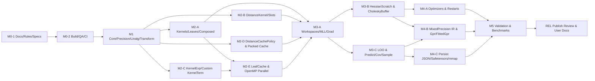

# Roadmap

The canonical source for the order and state of work. A row carries only its ID, kind, title, Issue, and state; detailed completion criteria are written in the Issue. Rows are added or removed only after a Grill, and only the PR that finishes a row rewrites "Now".

**Now**: complete (all rows through REL-8 are done)

The goal is to provide the **Exact GPR** model as the C++23 static library `cxxgpr` without compromising numerics, API, persistence, or performance. The work has completed the repository foundation (M0-1), the build, check, and CI foundation (M0-2), the core foundation (M1-1), the precision foundation (M1-2), the linear algebra foundation (M1-3), the preprocessing foundation (M1-4), the M2 kernel foundation (M2-A to M2-E), workspaces with MLL and analytic gradients (M3-A), analytic Hessians with memory/speed-first integration (M3-B), LOO inference with prediction and sampling (M3-C), the in-house optimizers (M4-A), the public model integration (M4-B), persistence (M4-C), the integrated validation and benchmarks (M5-1 to M5-4), the publication preparation (REL-1, REL-2), and the user documentation (REL-3), the release workflow (REL-4), and the specification, training, inference and persistence of the supplied-distance models (REL-5 to REL-7). The first release is the owner's decision; see [release.md](release.md).

The quality-control mechanisms (traceability, baseline results, result-change records, provenance, platform qualification) are in the [quality assurance plan](quality/quality-plan.md); the mapping between IDs and tests is in the [traceability matrix](quality/traceability.md).

State words: `Todo`, `Decompose after Grill`, `In progress`, `Done`. `Done` means the row's own completion criteria are met; it does not imply completion of downstream verification or benchmarks.

## Dependencies

## M0: Development foundation

| ID | Kind | Title | Issue | State |
|---|---|---|---|---|
| M0-1 | Task | Repository foundation: development conventions, Rules/Skills, specifications, and roadmap | #1 | Done |
| M0-2 | Task | Build, check, and CI foundation: CMake, vcpkg, GTest, quality and specification check tools, GitHub Actions | #2 | Done |

## M1: Core, linear algebra, precision, and preprocessing foundations

| ID | Kind | Title | Issue | State |
|---|---|---|---|---|
| M1-1 | Feat | Core foundation: `GprError`, `Interval`, `GaussianLikelihood`, checked dimensions, `Xoshiro256++`, view types | #6 | Done |
| M1-2 | Feat | Precision foundation: `DoublePrecision` / `SinglePrecision` / `MixedPrecision` and the iterative-refinement engine | #8 | Done |
| M1-3 | Feat | Linear algebra foundation: Eigen LLT (`uplo=Lower`), triangular solves, adaptive Jitter, compensated summation and OpenMP helpers | #10 | Done |
| M1-4 | Feat | Preprocessing foundation: `Identity`, `Standardize`, `MinMax`, `Pipeline`, `ColumnwiseInput`, custom interface | #11 | Done |

## M2: Kernels, distance supply, and extension points

| ID | Kind | Title | Issue | State |
|---|---|---|---|---|
| M2-A | Feat | The 10 built-in kernel leaves (RBF/Matérn/Periodic/RQ each Isotropic and ARD, Constant/Linear/White) and `KernelSpec` to `CompiledKernel` | #14 | Done |
| M2-B | Feat | Supplied squared distances: `ScalarDistance`, `ArdDistance`, `DistanceKernel<DistanceOnly \| WithPoints>`, `tidy` | #16 | Done |
| M2-C | Feat | `KernelExp::{Accurate, FastApprox}` and user-defined `KernelTerm<T>` | #18 | Done |
| M2-D | Feat | `DistanceCachePolicy::{Cached, Uncached}` and the packed lower-triangular cache of raw $(\Delta x_d)^2$ | #20 | Done |
| M2-E | Feat | Incremental `LeafCache` updates, bitwise verification of `USES_CHANGE_INDICES`, OpenMP column parallelism | #22 | Done |

## M3: Exact GPR numerics, workspaces, and inference

| ID | Kind | Title | Issue | State |
|---|---|---|---|---|
| M3-A | Feat | Workspaces (`WorkspaceCore`/`FitBuffers`/`QueryWorkspace`), MLL, and `keep_plan` analytic gradients | #24 | Done |
| M3-B | Feat | Analytic Hessian (`HessianScratch`), `CholeskyBuffer::{Retain, Reuse}`, `with_prefer_memory` / `speed` | #26 | Done |
| M3-C | Feat | LOO inference (GPML §5.4.2), `predict` / `predict_into` / `predict_covariance` / `sample` | #28 | Done |

## M4: Optimization, integrated model, and persistence

| ID | Kind | Title | Issue | State |
|---|---|---|---|---|
| M4-A | Feat | In-house optimizers: `Lbfgs` (Moré–Thuente), `NelderMead`, `TrustRegion` (Steihaug–Toint CG), `FastSimulatedAnnealing`, `Fixed`, logit transform, `with_restarts` | #30 | Done |
| M4-B | Feat | Public models `Gpr<O, P, K>` and `FittedGpr<O, P, K>` integration (`fit`/`factor`/`refit`/`into_trainer`, `MixedPrecision` integration) | #32 | Done |
| M4-C | Feat | Persistence `cxxgpr::persist`: `config.json` / `model.safetensors`, atomic save, `f64` mmap loading, `PersistRegistry` | #34 | Done |

## M5: Integrated validation, benchmarks, and contract coverage

| ID | Kind | Title | Issue | State |
|---|---|---|---|---|
| M5-1 | Test | All-pairs integration tests (`path_matrix` over 10 kernels x 5 optimizers x 3 precisions x distance supply and preprocessing) | #36 | Done |
| M5-2 | Test | Golden numerical comparison against reference-implementation output, `scikit-learn`, and analytic solutions (fixed θ, L-BFGS optimization, LOO) | #38 | Done |
| M5-3 | Test | Zero hot-path allocation and ratchet tests (MLL+grad, `predict_into`, coordinate-ratio bound for distance supply) | #40 | Done |
| M5-4 | Feat | Google Benchmark suite (Forrester $n=256$ / ARD Sphere, `KernelExp`, distance-supply comparison) | #42 | Done |

## REL: Release preparation

| ID | Kind | Title | Issue | State |
|---|---|---|---|---|
| REL-1 | Design | Final confirmation of the public scope and release format (vcpkg/CMake install package, etc.) | #44 | Done |
| REL-2 | Task | Publication review gate (`publish-review`, third-party notices, bilingual README check) | #46 | Done |
| REL-3 | Task | User documentation: Diataxis-structured user docs (en/ja) covering every public API | #82 | Done |
| REL-4 | Task | Release workflow (draft GitHub Release with per-platform packages and documentation) and README rewrite | #91 | Done |
| REL-5 | Design | Supplied-distance models: specification of `DistanceGpr` / `FittedDistanceGpr` (DES-21) | #104 | Done |
| REL-6 | Feat | `DistanceGpr` / `FittedDistanceGpr`: fit, factor, predict, covariance, sampling, LOO for `DistanceOnly` and `WithPoints` | #105 | Done |
| REL-7 | Feat | Persistence of supplied-distance models (FMT-07, `LoadedDistanceGpr<C>`) | #106 | Done |
| REL-8 | Design | Decide the `MixedPrecision<PromoteStorage>` acceptance rule (DES-05) | #108 | Done |

## Out of scope

The following are outside the scope of this repository and must not leak into the API or the design documents.

- Sparse GPR models (`Sgpr`, `Svgp`) and inducing-point coordinate derivatives (`grad_cross`, `hess_cross`, `grad_wrt_coord_dim`, `*_wrt_sq_dist`)
- Online incremental-learning models (`OnlineGpr`, `into_online`, `LdltStore`, `PointId`) and the `ldlt` persistence format
- Adding external optimization libraries (`LBFGS++`, `Ceres`, `NLopt`, etc.) as dependencies
