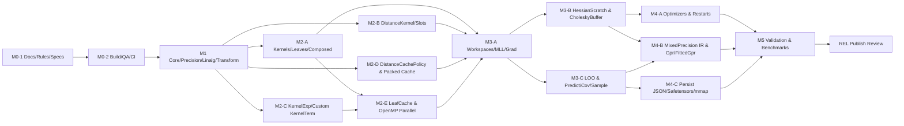

# ロードマップ

作業の順序と状態の正本。行が持つのは ID、種類、題、Issue、状態だけであり、詳細な完了条件は Issue に書く。行の追加と削除は Grill の後に行い、「今」を書き換えるのはその行を終える PR だけとする。

**今**：M4-A

目的は、Rust ライブラリ `gprx` の **Exact GPR** モデルを、C++23 静的ライブラリ `cxxgpr` として数値・API・永続化・性能の妥協なく移植することである。現在地はリポジトリ基盤（M0-1）・ビルド・検査・CI 基盤（M0-2）・コア基盤（M1-1）・精度基盤（M1-2）・線形代数基盤（M1-3）・前処理基盤（M1-4）・M2 カーネル基盤（M2-A〜M2-E）・ワークスペースと MLL・解析勾配（M3-A）・解析ヘッセ行列とメモリ/速度優先統合（M3-B）・LOO 推論と予測・サンプリング（M3-C）を完了し、自前最適化器群（M4-A）へ進む段階である。

品質管理の仕組み（追跡・基準結果・結果変更記録・来歴・プラットフォーム認定）は [品質保証計画](quality/quality-plan.md)、ID と試験の対応は [追跡表](quality/traceability.md) にある。

状態の語：`Todo`、`Grill後に分解`、`In progress`、`Done`。`Done` は行自身の完了条件を満たしたことを指し、下流の検証・ベンチマーク完了を意味しない。

## 依存

## M0：開発基盤

| ID | 種類 | 題 | Issue | 状態 |
|---|---|---|---|---|
| M0-1 | Task | リポジトリ基盤：開発規約、Rules／Skills、仕様書、ロードマップの整備 | #1 | Done |
| M0-2 | Task | ビルド・検査・CI 基盤：CMake、vcpkg、GTest、品質・仕様検査ツール、GitHub Actions の構築 | #2 | Done |

## M1：コア・線形代数・精度・前処理基盤

| ID | 種類 | 題 | Issue | 状態 |
|---|---|---|---|---|
| M1-1 | Feat | コア基盤：`GprError`・`Interval`・`GaussianLikelihood`・checked 寸法・`Xoshiro256++`・ビュー型 | #6 | Done |
| M1-2 | Feat | 精度基盤：`DoublePrecision` / `SinglePrecision` / `MixedPrecision` と反復改良エンジン | #8 | Done |
| M1-3 | Feat | 線形代数基盤：Eigen LLT（`uplo=Lower`）、三角求解、適応的 Jitter、補償・OpenMP 補助 | #10 | Done |
| M1-4 | Feat | 前処理基盤：`Identity`・`Standardize`・`MinMax`・`Pipeline`・`ColumnwiseInput`・カスタム I/F | #11 | Done |

## M2：カーネル・距離供給・拡張点

| ID | 種類 | 題 | Issue | 状態 |
|---|---|---|---|---|
| M2-A | Feat | 組込みカーネル 10 葉（RBF/Matérn/Periodic/RQ 各 Isotropic・ARD、Constant/Linear/White）と `KernelSpec`→`CompiledKernel` | #14 | Done |
| M2-B | Feat | 供給二乗距離：`ScalarDistance`・`ArdDistance`・`DistanceKernel<DistanceOnly \| WithPoints>`・`tidy` | #16 | Done |
| M2-C | Feat | `KernelExp::{Accurate, FastApprox}`・ユーザー定義 `KernelTerm<T>` | #18 | Done |
| M2-D | Feat | `DistanceCachePolicy::{Cached, Uncached}` と生 `(Δx_d)²` 詰め下三角キャッシュ | #20 | Done |
| M2-E | Feat | `LeafCache` 増分更新、`USES_CHANGE_INDICES` ビット一致検証、OpenMP 列並列化 | #22 | Done |

## M3：Exact GPR 数理演算・ワークスペース・推論

| ID | 種類 | 題 | Issue | 状態 |
|---|---|---|---|---|
| M3-A | Feat | ワークスペース（`WorkspaceCore`/`FitBuffers`/`QueryWorkspace`）と MLL・`keep_plan` 解析勾配 | #24 | Done |
| M3-B | Feat | 解析ヘッセ行列（`HessianScratch`）・`CholeskyBuffer::{Retain, Reuse}`・`with_prefer_memory` / `speed` | #26 | Done |
| M3-C | Feat | LOO 推論（GPML §5.4.2）・`predict` / `predict_into` / `predict_covariance` / `sample` | #28 | Done |

## M4：最適化・統合モデル・永続化

| ID | 種類 | 題 | Issue | 状態 |
|---|---|---|---|---|
| M4-A | Feat | 自前最適化器：`Lbfgs`（Moré–Thuente）・`NelderMead`・`TrustRegion`（Steihaug–Toint CG）・`FastSimulatedAnnealing`・`Fixed`・logit 変換・`with_restarts` | - | Todo |
| M4-B | Feat | 公開モデル `Gpr<O, P, K>`・`FittedGpr<O, P, K>` 統合（`fit`/`factor`/`refit`/`into_trainer`、`MixedPrecision` 統合） | - | Todo |
| M4-C | Feat | 永続化 `cxxgpr::persist`：`config.json` / `model.safetensors`、原子保存、`f64` mmap 読込、`PersistRegistry` | - | Todo |

## M5：総合検証・ベンチマーク・契約網羅

| ID | 種類 | 題 | Issue | 状態 |
|---|---|---|---|---|
| M5-1 | Test | 全ペア結合試験（10 カーネル × 5 最適化器 × 3 精度 × 距離供給・前処理の `path_matrix`） | - | Todo |
| M5-2 | Test | `gprx` / `scikit-learn` / 解析解 golden 数値照合（fixed θ、L-BFGS 最適化、LOO） | - | Todo |
| M5-3 | Test | ホットパス確保ゼロ・ラチェット試験（MLL+grad・`predict_into`・距離供給の座標比上限） | - | Todo |
| M5-4 | Feat | Google Benchmark スイート（Forrester $n=256$ / ARD Sphere・`KernelExp`・距離供給比較） | - | Todo |

## REL：公開準備

| ID | 種類 | 題 | Issue | 状態 |
|---|---|---|---|---|
| REL-1 | Design | 公開範囲・リリース体裁（vcpkg/CMake install package 等）の最終確認 | - | Todo |
| REL-2 | Task | 公開審査ゲート（`publish-review`・第三者通知・バイリンガル README 検査） | - | Todo |

## 範囲に入れないもの

次はこのリポジトリの移植対象外とし、API や設計書へ混入させない。

- Sparse GPR モデル（`Sgpr`, `Svgp`）および誘導点座標微分（`grad_cross`, `hess_cross`, `grad_wrt_coord_dim`, `*_wrt_sq_dist`）
- オンライン逐次学習モデル（`OnlineGpr`, `into_online`, `LdltStore`, `PointId`）および `ldlt` 永続化形式
- 外部最適化ライブラリ（`LBFGS++`, `Ceres`, `NLopt` 等）の依存追加
